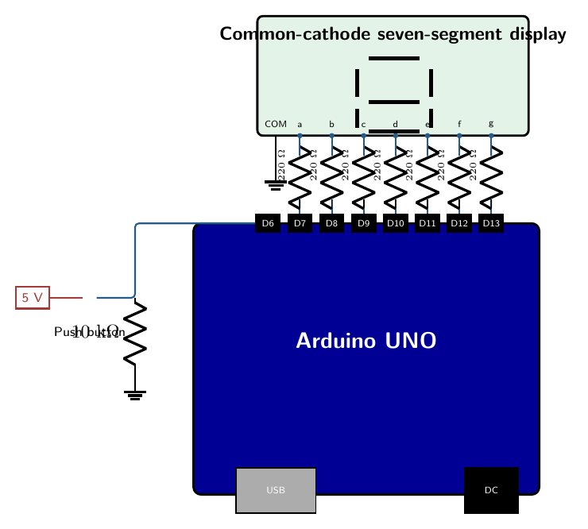
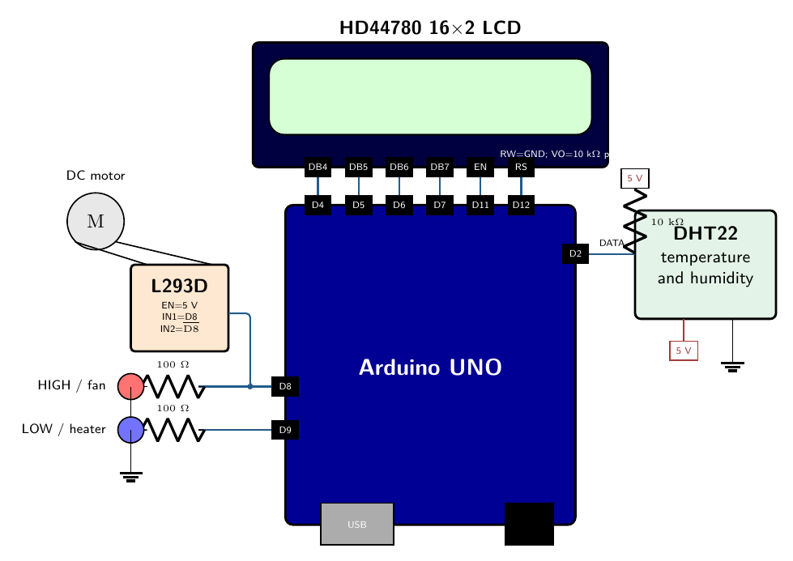
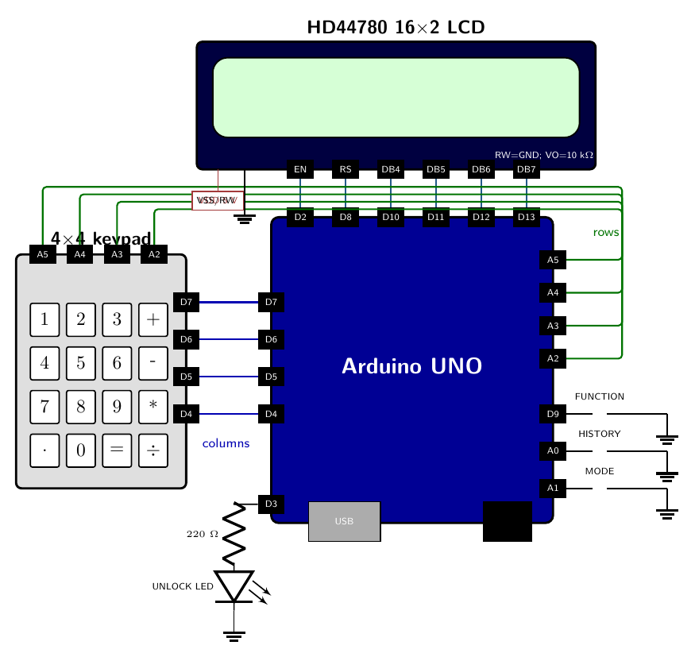
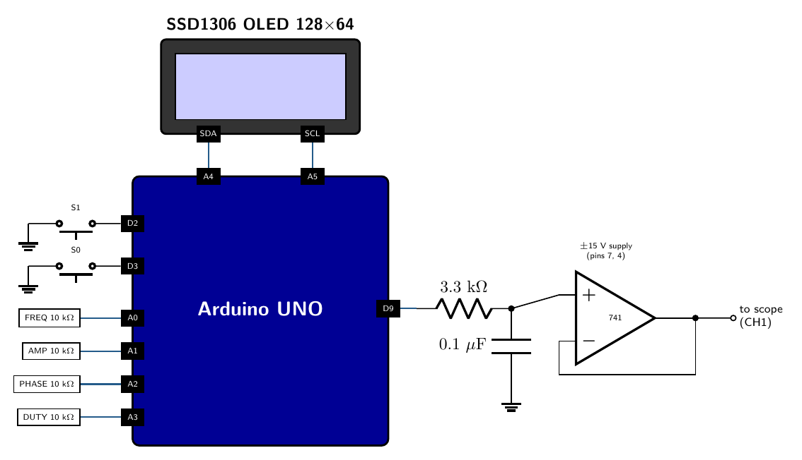
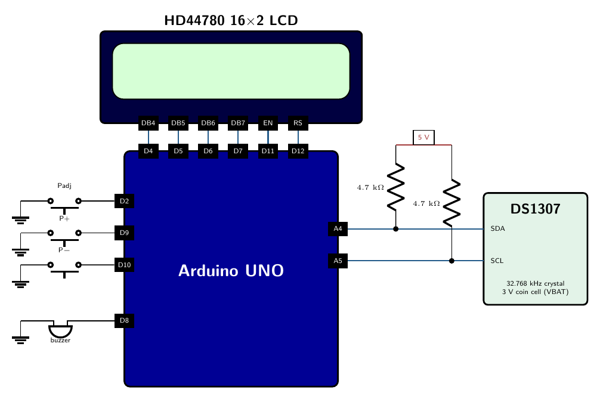
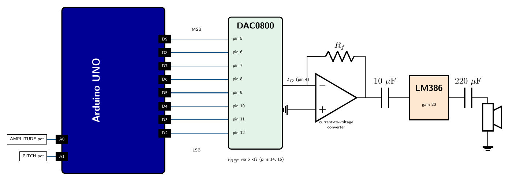

# ELL305 Project and ELP305 Experiments

This repository has two parts:

- [`project`](project): the complete code of the ELL305 (Computer Architecture, IIT Delhi) project, **Throughput Limits of a Microcontroller UART**.
- [`exp00`](exp00) to [`exp05`](exp05): the first six ELP305 laboratory experiments, done as preparation for the project.

## Project: Throughput Limits of a Microcontroller UART

The project measures what limits the error-free speed of the ATmega328P UART on an Arduino Uno (16 MHz). The board sends bytes to itself through a wire from pin 1 (TX) to pin 0 (RX) and counts how many arrive.

| Folder | Program | Wiring |
|---|---|---|
| [`project/uart_loopback`](project/uart_loopback) | Interrupt-driven transmit, polled receive: the main measurement | pin 1 to pin 0 |
| [`project/uart_lean`](project/uart_lean) | Transmit and receive both polled, no interrupts | pin 1 to pin 0 |
| [`project/uart_sweep`](project/uart_sweep) | Sweep of the extra work per byte at every baud rate | pin 1 to pin 0 |
| [`project/uart_demo`](project/uart_demo) | Oscilloscope demonstration, modes 0 to 3, with debug pins D8, D9, D10 | pin 1 to pin 0; mode jumpers on D4 and D5 |
| [`project/uart_rc_dump`](project/uart_rc_dump) | Constant-pattern test for the RC line: which bits go wrong | pin 1, 330 ohm, pin 0; capacitor from pin 0 to GND |
| [`project/uart_2m_check`](project/uart_2m_check) | Check that transmission stays back to back at 2 Mbaud | same RC line |
| [`project/uart_u2x_check`](project/uart_u2x_check) | Normal against double-speed sampling at the same baud rate | same RC line |

All programs are for the Arduino Uno and print their results as CSV on the Serial Monitor at 9600 baud. Remove the wire from pin 0 while uploading.

**Documentation.** The code is documented with Doxygen comments. To build the HTML pages, install Doxygen and run `doxygen` in the repository root (it reads [`Doxyfile`](Doxyfile)); the pages are written to `docs/html`.

---

## ELP305 Embedded Lab: Experiments 0 to 5

Code, circuits and simulations for the first six ELP305 laboratory experiments ([experiment sheets](https://sites.google.com/view/embedded-lab/elp-305)). They were done as preparation for the ELL305 (Computer Architecture) project at IIT Delhi.

All sketches are for the **Arduino Uno (ATmega328P, 16 MHz)**. Each folder contains:
- the sketch (`.ino`)
- a compiled `.hex` file
- the circuit diagram (`circuit.png`)
- a SimulIDE 1.1.0-SR2 circuit (`.sim1`), where one exists

| Exp. | Folder | Title | Simulation |
|---|---|---|---|
| 0 | [`exp00`](exp00) | Introduction to Arduino | `exp00.sim1` |
| 1 | [`exp01`](exp01) | Interfacing with Arduino | `exp01.sim1` |
| 2 | [`exp02`](exp02) | Calculator and Digi-lock | `exp02.sim1` |
| 3 | [`exp03`](exp03) | Quick-and-Dirty Function Generator | `exp03.sim1` |
| 4 | [`exp04`](exp04) | Using the I2C Bus: Real-Time Clock | not built (see below) |
| 5 | [`exp05`](exp05) | Audio Playback with Modulation | none (built on hardware) |

Experiments 0 to 3 were implemented on the Arduino and simulated in SimulIDE. **Experiment 5 was built and tested on hardware.** **Experiment 4 was not built on hardware**, because the DS1307 real-time-clock module was not available in the laboratory. Its program compiles for the Uno and is given as a design.

---

## Experiment 0: Introduction to Arduino

**Aim.** Make a decimal counter with a push button and a common-cathode seven-segment display.

**Circuit and working.**
- Pins D7 to D13 drive segments a to g through 220 ohm resistors.
- The button on D6 has a 10 kohm pull-down, so the input cannot float when the button is released.
- Every 100 ms the program checks the button. On a press it clears all segments, advances the count with n = (n + 1) mod 10, and lights the pattern for the new digit.



**Verification.** Each press must advance the display by one digit and wrap from 9 to 0. The count must not change while the button is released.

**Remarks.**
- After each press the program waits about 1.15 s. This hides contact bounce, but a button held down keeps counting about once a second.
- The input is read as a level, not as an edge.

## Experiment 1: Interfacing with Arduino

**Aim.** Read the temperature with a DHT22 sensor, show it on a 16x2 LCD, and indicate whether it is low, normal or high.

**Circuit and working.**

| Signal | Arduino pin |
|---|---|
| DHT22 data (10 kohm pull-up) | D2 |
| LCD RS, EN | D12, D11 |
| LCD DB4 to DB7 | D4 to D7 |
| High temperature / fan indicator, L293D input | D8 |
| Low temperature / heater indicator | D9 |

- The sensor is read once a second. Below 20 °C the program shows LOW, from 20 to 30 °C NORMAL, and above 30 °C HIGH. It drives the matching output.
- An invalid reading (`isnan`) shows "Sensor Error" and leaves the outputs unchanged.
- D8 also drives an L293D motor driver. An inverter gives the complementary direction input.



**Remarks.**
- There is no hysteresis, so a temperature sitting on a threshold can make the outputs switch back and forth.
- The LCD is cleared on every loop, which makes it flicker slightly.

## Experiment 2: Calculator and Digi-lock

**Aim.** Build a keypad calculator for multi-digit and decimal expressions, and a password lock on the same hardware.

**Circuit and working.**

| Signal | Arduino pin |
|---|---|
| Keypad rows R1 to R4 | A5 to A2 |
| Keypad columns C1 to C4 | D7 to D4 |
| LCD RS, EN | D8, D2 |
| LCD DB4 to DB7 | D10 to D13 |
| FUNCTION, HISTORY, MODE buttons (to GND, internal pull-ups) | D9, A0, A1 |
| Unlock LED (through 220 ohm) | D3 |

- **Calculator:** a recursive-descent parser evaluates the expression, with one function per precedence level. Multiplication and division therefore bind more tightly than addition and subtraction, and brackets and `sqrt()` can be nested. Division by zero is reported as an error.
- **Buttons:** they are debounced for 30 ms. FUNCTION selects a second key layer (square root, brackets, exponent, clear, delete). HISTORY scrolls through the last five results. MODE switches to the digi-lock.
- **Digi-lock:** the operator keys enter the letters A to D. A correct password lights the LED. Three wrong attempts block input for 15 s. Lock events are logged over the serial port.



**Remarks.**
- The passwords are stored as plain text in the program.
- The expression is kept in an Arduino `String`, which allocates memory dynamically. With 2 kB of RAM this works for 40 characters but would not scale.

## Experiment 3: Quick-and-Dirty Function Generator

**Aim.** Generate sine, triangle, square and variable-duty pulse waveforms with adjustable frequency, amplitude and phase, and display the selected waveform.

**Circuit and working.**
- **PWM output:** Timer1 produces 8-bit fast PWM on D9 at 16 MHz / 256 = 62.5 kHz.
- **Waveform generation:** Timer2 interrupts at 50 kHz. Each interrupt adds a 32-bit phase step to an accumulator (direct digital synthesis). The top 8 bits index a 256-entry waveform table, and the amplitude-scaled sample is written to `OCR1A`.
- **Analog output:** a 3.3 kohm / 0.1 µF filter removes the PWM carrier, and an LM741 voltage follower on ±15 V buffers the output.
- **Controls:** switches on D2 and D3 select the waveform. Potentiometers on A0 to A3 set the frequency (5 to 100 Hz), amplitude (0 to 2.5 V peak), phase and pulse duty.
- **Display:** an SSD1306 OLED on I2C (A4/A5) draws one period with auto-scaled axes. The settings are also printed over the UART at 115200 baud.



**Verification.** Each switch code must give the selected waveform. The frequency must follow f = step × 50000 / 2^32. Waveform timing must not change while the OLED is being redrawn.

**Remarks.**
- The filter corner is 1 / (2π × 3300 × 0.1 µF) ≈ 482 Hz. The 62.5 kHz carrier is reduced by about 42 dB, while a 100 Hz sine passes almost unchanged.
- The interrupt has 16 MHz / 50 kHz = 320 CPU cycles per sample.

## Experiment 4: Using the I2C Bus: Real-Time Clock

**Aim.** Read the time from a DS1307 real-time clock over I2C, show it on a 16x2 LCD, and sound an alarm set with three push buttons (Padj, P+, P−).

**Status: not built on hardware.** The DS1307 module was not available in the laboratory. The program compiles for the Uno (7.3 kB of flash, 559 bytes of RAM), and the circuit is given below.

**Circuit and working.**

| Signal | Arduino pin |
|---|---|
| DS1307 SDA, SCL (4.7 kohm pull-ups to 5 V) | A4, A5 |
| LCD RS, EN | D12, D11 |
| LCD DB4 to DB7 | D4 to D7 |
| Padj, P+, P− buttons (to GND, internal pull-ups) | D2, D9, D10 |
| Buzzer | D8 |

- **Clock:** the DS1307 is accessed directly with `Wire`. The program writes the register pointer (0x00), then reads 3 bytes: seconds, minutes and hours in BCD. If the clock-halt bit is set at power-up, the clock is started with the compile time.
- **Alarm setting:** Padj steps through five states, as on the experiment sheet. The first press enters alarm-setting mode, the next three select hour, minute and second (the selected field blinks), and the fifth press arms the alarm. P+ and P− change the selected field.
- **Alarm:** when the time matches, the buzzer beeps for up to 30 s, or until any button is pressed.
- **Time drift:** the program prints the RTC time and `millis()` once a minute over the serial port (9600 baud). It accepts `Thhmmss` to set the clock from a reference.

The structs are defined in `types.h`, because the Arduino IDE inserts function prototypes above any struct defined in the `.ino`.



**Remarks.**
- A typical ±20 ppm crystal error is 86400 × 20 × 10⁻⁶ ≈ 1.7 s per day. The serial log would measure this against a reference clock.
- D3 is avoided because it is faulty on the board used for the project.

## Experiment 5: Audio Playback with Modulation

**Aim.** Play audio through an 8-bit parallel DAC0800 and an LM386 amplifier, with potentiometers controlling amplitude and frequency.

**Status: built and tested on hardware.** The analog stage uses the standard circuits from the DAC0800 and LM386 datasheets: a 5 kohm reference resistor, an op-amp current-to-voltage converter, a 10 µF coupling capacitor, the LM386 at its default gain of 20, and a 220 µF output capacitor to the speaker.

**Circuit and working.**
- **DAC bus:** D2 to D9 form the 8-bit bus, from D2 to DAC pin 12 (LSB) up to D9 to pin 5 (MSB). It is written with two port stores (`PORTD`, `PORTB`), so all eight bits change within a few cycles.
- **Sound generation:** Timer1 interrupts at 16 kHz. Each interrupt advances a 16-bit phase accumulator and outputs one point of a 16-sample sine table. The main loop plays a 14-note melody.
- **Modulation:** the A0 potentiometer scales each sample about the mid-level 128 (amplitude). The A1 potentiometer multiplies the phase step by 0.5 to 2 (pitch).
- **Analog stage:** the DAC output current is converted to a voltage and fed through a coupling capacitor to the LM386 and the speaker.



**Verification.** The melody must play in the right order. A0 must change loudness without changing pitch, and A1 must change pitch without changing loudness.

**Remarks.**
- With only 16 samples per cycle, the output has strong components near 16 times the note frequency, which the amplifier and speaker partly filter.
- The highest note at double pitch (880 Hz) still has 18 samples per period.

---

## Running the code

**Simulation:** open the `.sim1` file in SimulIDE 1.1.0-SR2 and press the power button. The `.hex` file must stay in the same folder. After editing a sketch, recompile it and replace the `.hex`.

**Hardware or command line:**

```bash
arduino-cli compile -b arduino:avr:uno exp02
arduino-cli upload  -b arduino:avr:uno -p COM3 exp02
```

The `.hex` files were built with arduino-cli 1.5.1, Arduino AVR core 1.8.8 and avr-gcc 7.3.0. Replace `COM3` with your board's port.

### Libraries (Arduino Library Manager)

| Library | Version | Used by |
|---|---|---|
| LiquidCrystal | 1.0.7 | Exp 1, 2, 4 |
| DHT sensor library (Adafruit) | 1.4.7 | Exp 1 |
| Adafruit Unified Sensor | 1.1.15 | Exp 1 |
| Keypad | 3.1.1 | Exp 2 |
| U8g2 | 2.36.15 | Exp 3 |

## Author

Harshal Narsaria, IIT Delhi. All intellectual property rights belong to IIT Delhi.
